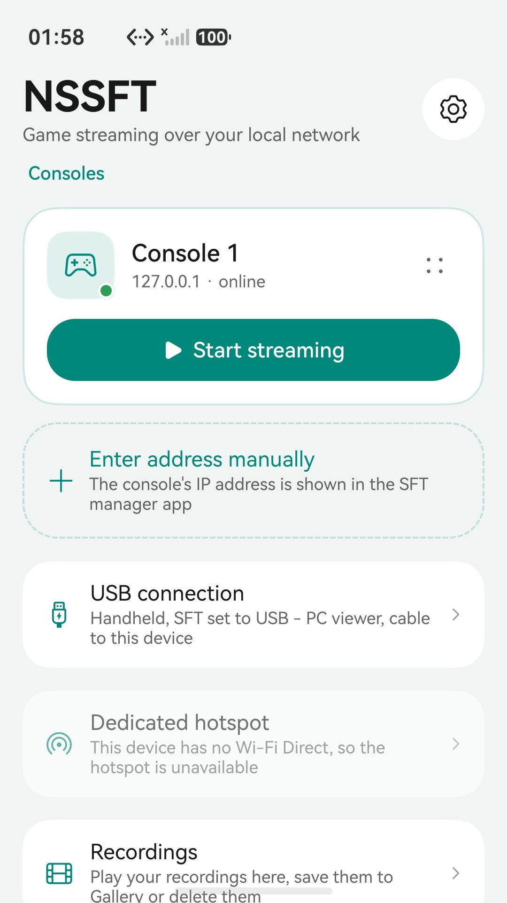
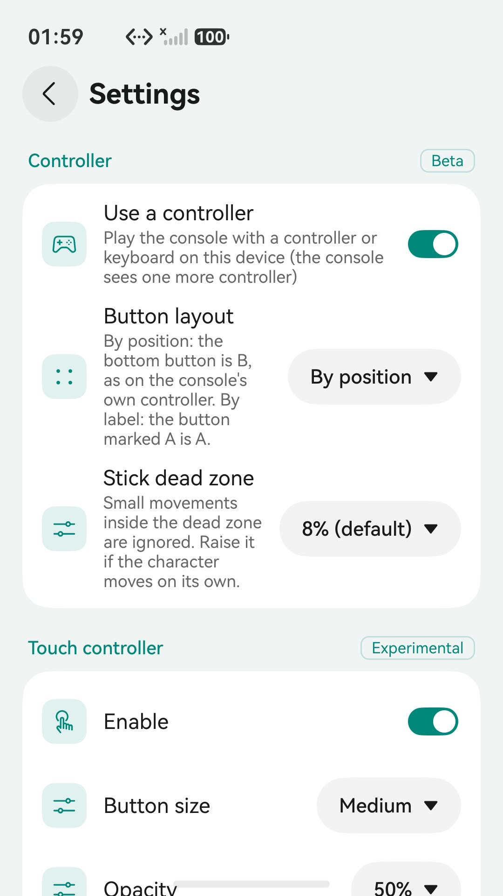
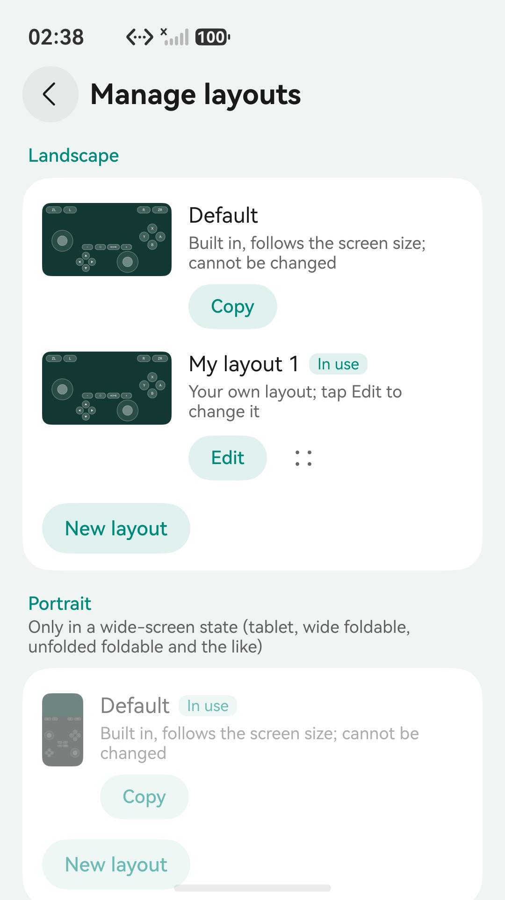
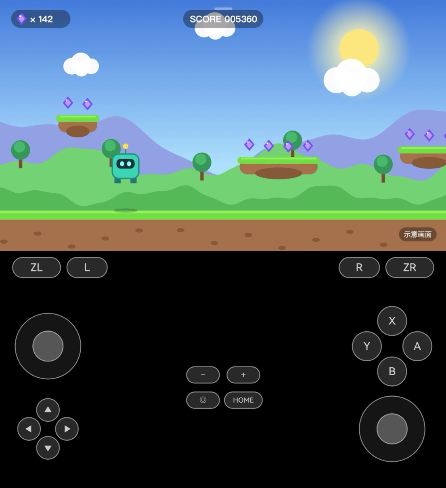
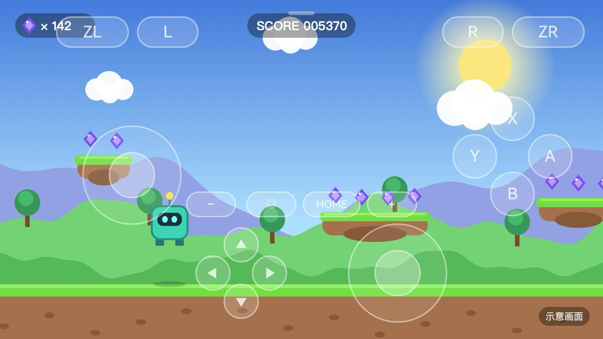

# NSSFT: a native HarmonyOS client for SFT

[简体中文](README.zh-CN.md)

NSSFT receives the stream sent by the console side of [SFT](https://github.com/TomasUribe/switch-frame-tap) (over the network or USB) on HarmonyOS phones, tablets, PCs and TVs, at up to 1080p and 60 fps, with game sound. You can also play the console with a controller, a keyboard or an on-screen touch controller, and record your sessions.

> NSSFT is an independent third-party open-source project. It is not affiliated with, endorsed by or sponsored by the console maker or the author of SFT. NSSFT only receives and plays the SFT stream and sends controller input back to it; it does not include or modify any software on the console.

## Screenshots

<p>



</p>

<p>


</p>

Left: portrait on an unfolded foldable (Mate X7), with the picture at the top and the touch controller in the space below. Right: landscape on a phone, with the touch controller over the picture.

## Features

- **Discovery**: consoles that broadcast on the local network are listed automatically, or enter an address; consoles you have used stay on the home screen and can be renamed.
- **Up to 1080p60**: the hardware decoder is configured from the size the console sends and rebuilt when it switches between 720p and 1080p.
- **USB**: with SFT set to USB - PC viewer, connect a data cable; the console shows up on the home screen.
- **Low-latency playback**: hardware decoding and low-latency OHAudio; frames are presented on VSync as soon as they are decoded, with no extra buffering.
- **Frame loss guard**: if the video sequence ever skips, the last good picture is held and a keyframe is requested at once (`SFTK`), so the picture never smears. SFT's links do not drop frames in practice, so this stays on quietly with no setting.
- **Picture enhancement** with the system video processing engine, where supported.
- **Dedicated 5 GHz hotspot** for the console over Wi-Fi Direct.
- **Controllers and keyboards** (beta): play the console with a controller or keyboard connected to the device; they are merged into one controller on the console. Button layout (by position or by label) and the stick dead zone can be adjusted. Needs "Controls from the viewer" turned on in SFT (0.7.20 or later).
- **Touch controller** (phones and tablets, experimental: still being tuned, and it suffers on a shaky network; see the in-app guide): on-screen buttons over the picture with a floating left stick and a light buzz on press. Make your own layouts by moving, resizing and hiding buttons. Landscape and portrait keep separate layouts: by default the buttons go around the edges in landscape and below the picture in portrait (shoulder buttons right under it, two rows on each side, minus/capture/HOME/plus in the middle). On tablets, unfolded foldables and other wide screens the stream follows the system rotation, or you can fix it to landscape or portrait; phones and the outer screen of foldables stream in landscape.
- **Picture position**: when there is empty space above and below the picture (a tablet held upright, an unfolded foldable, a tri-fold), drag the picture to the top, the middle or the bottom; each screen shape remembers its own position. The picture and the touch controller are separate layers, so moving one never moves the other.
- **Side menu**: the menu button at the top center (it shrinks to a thin line after a few seconds) opens sound, controller, picture position, recording and streaming options; back never stops the stream by accident, you leave from the menu. An optional stats overlay shows the link, frame rate, bitrate and latency.
- **Picture-in-picture**: keep watching in a small window when you leave the app.
- **Recording**: record while streaming, or record only with no picture on screen (it keeps going in the background and with the screen locked). A second hardware decoder feeds the hardware encoder, so the stream is compressed on the device into an H.265 MP4 without touching playback. Three quality levels (about 90 / 60 / 30 MB a minute); recordings can be saved to Gallery.
- **Devices**: phones, tablets, PCs/2-in-1s and TVs (remote control). The AppGallery build leaves out TVs; see Build.
- **Three languages** (Simplified Chinese, Traditional Chinese, English) and dark mode.

## Protocol

SFT's stream protocol, SFTR v2 (see `core/sft_protocol.*`):

- The console accepts one client on **TCP 9950**; while none is connected it broadcasts `SFTAP1 <ip> 9950 <name>` on **UDP 9951** every second.
- Each packet is a 32-byte little-endian header (magic `SFTR`, version 2, flags, width, height, console-side age, length, crop, sequence) plus the payload: one H.264 Annex-B access unit, 48 kHz stereo 16-bit PCM, or a status packet that says why there is no picture.
- The client can write requests on the same connection, such as `SFTK` (send a keyframe now).
- When the header flags include 128, the console accepts controller input: 32-byte `SFTI` messages (magic, flags,
  buttons, both sticks), sent on every change and again every 100 ms (see `core/sft_pad.*`).

## Layout

```
core/                 platform-independent C++ (also built and tested on desktop)
  sft_protocol        header, status packet and broadcast parsing
  sft_receiver        reads and checks packets, keyframe requests and stats, shared by network and USB
  sft_net_source      TCP receiving, reconnects, UDP discovery
  sft_usb_source      USB streaming (SFT's USB - PC viewer mode)
  sft_pad             SFTI controller messages and the thread that sends them
  gop_cache           keeps the latest GOP so the picture is live again right after returning to the app
  frame_loss          frame interval estimate and loss causes
harmony/              DevEco project
  entry/src/main/cpp/ session, hardware decoding, enhancement, audio, recording, NAPI
  entry/src/main/ets/ UI: console cards, player, touch controller, settings, recordings, guide, about
tools/
  mock_sft.py         simulates the console (broadcast + TCP stream, controller input) for testing without one
  sft_probe.cpp       desktop client built from the same core/
  test_host.sh        unit tests + end-to-end tests against the simulated console
  make_test_h264.swift  test stream with macOS VideoToolbox (1080p60 by default)
```

## Building

Needs DevEco Studio or the HarmonyOS command line tools (API 12 or later).

```sh
cd harmony
devecocli build                 # debug build; the repository has no signing configs, so the HAP is unsigned
```

The `default` and `release` products include TVs (for the open-source releases); the AppGallery build uses the `appgallery` product, which declares only phones, tablets and PCs/2-in-1s:

```sh
hvigorw assembleApp -p product=appgallery -p buildMode=release
```

Generate a debug signature in DevEco Studio under **File > Project Structure > Signing Configs** to install it on a device. Keep signing configs local; do not commit them.

## Unsigned builds

Every push is built by GitHub Actions ([`.github/workflows/build.yml`](.github/workflows/build.yml)), and every `v*` tag
publishes an **unsigned** HAP with its SHA-256 to [Releases](../../releases), with that version's section of
[CHANGELOG.md](CHANGELOG.md) as the release notes (the tag fails without one). Tags such as `v1.0.0-beta.1` are published
as pre-releases. These builds include TVs; the AppGallery version leaves them out, and is signed and built separately.

HarmonyOS only installs signed packages, so the unsigned HAP has to be signed with your own certificate first:

- You need a Huawei developer account, plus a debug certificate and a debug profile for your device from AppGallery
  Connect. The signing tool, `hap-sign-tool.jar`, comes with DevEco Studio and the Command Line Tools for HarmonyOS
  (`sdk/default/openharmony/toolchains/lib/`).
- A profile is issued for one bundle name, and `wilk.sft.next` is registered to the publisher's account. If you
  cannot get a profile for it, building from source is the simplest route: change `bundleName` in
  `harmony/AppScope/app.json5` to your own and follow [Building](#building).
- Certificates and profiles expire; sign again with renewed ones when they do.

```sh
java -jar hap-sign-tool.jar sign-app -mode localSign -signAlg SHA256withECDSA \
  -keystoreFile your.p12 -keystorePwd <store password> -keyAlias <alias> -keyPwd <key password> \
  -appCertFile your.cer -profileFile your.p7b \
  -inFile NSSFT-<version>-unsigned.hap -outFile NSSFT-<version>.hap
hdc install NSSFT-<version>.hap
```

The CI build uses [springtwr/harmonyos-clt](https://github.com/springtwr/harmonyos-clt), a community Docker image of
Huawei's Command Line Tools for HarmonyOS (26.0.0.851), pinned by digest.

## Testing

```sh
sh tools/test_host.sh           # unit tests + end-to-end (generates the test stream on macOS)
```

Without a console, the simulated server shows a picture on a real device:

```sh
swift tools/make_test_h264.swift build/test.h264 20
python3 tools/mock_sft.py --h264 build/test.h264 --audio
```

With the device and the computer on the same Wi-Fi, "mock console" appears on the home screen; otherwise enter the computer's IP address. Add `--input` to act as if "Controls from the viewer" is on; the controller input the device sends is printed.

## Support this project

NSSFT is a free, open-source project built in spare time. If it helps you, you can buy the author a coffee by scanning one of these codes:

| WeChat Pay | Alipay |
| :---: | :---: |
|  |  |

These go to the author of NSSFT. NSSFT only works because [SFT](https://github.com/TomasUribe/switch-frame-tap) captures and sends the picture on the console, and SFT is a separate, independent project. To support SFT's author as well, star the SFT repository or [buy them a coffee](https://www.buymeacoffee.com/papux200).

## License

GPL-2.0, the same as SFT; see [LICENSE](LICENSE).
