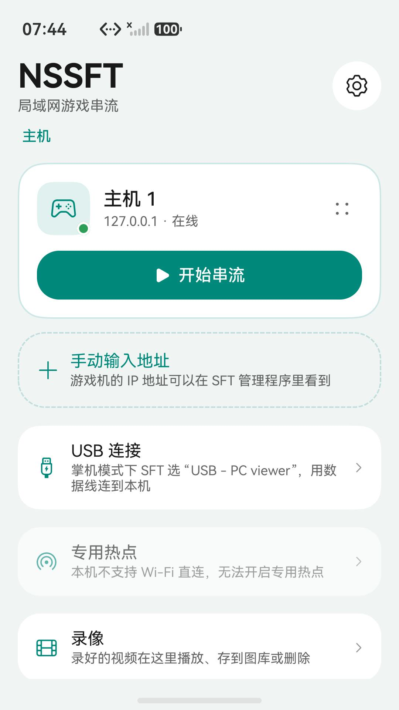
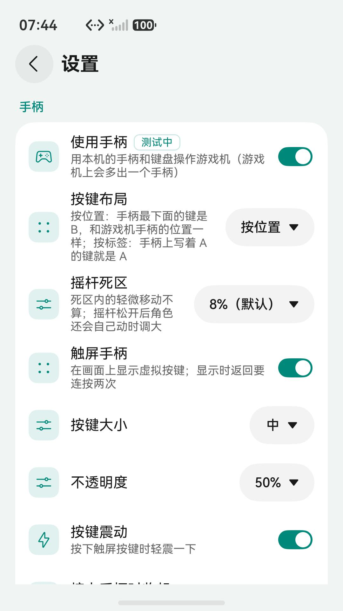
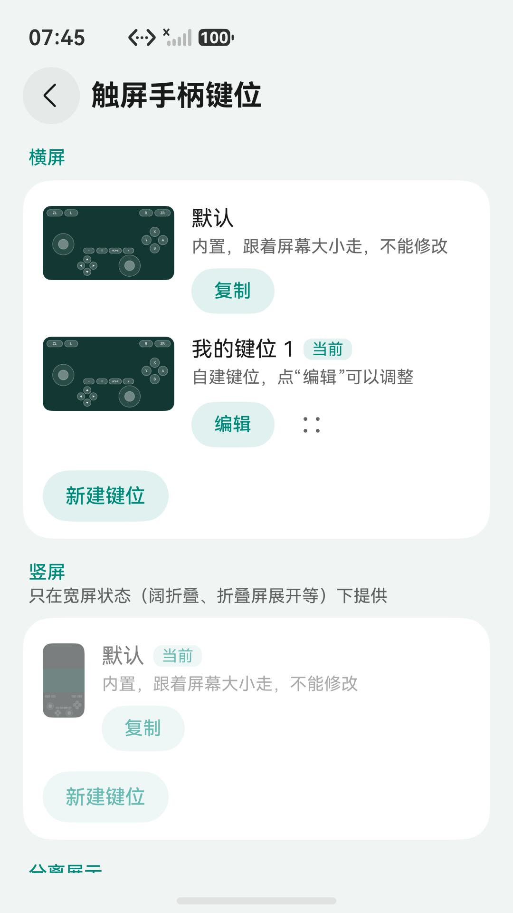

# NSSFT：SFT 的鸿蒙原生客户端

[English](README.md)

NSSFT 在 HarmonyOS 手机、平板、PC 和智慧屏上接收 [SFT](https://github.com/TomasUribe/switch-frame-tap) 游戏机端发出的串流（网络或 USB），最高 1080p 60 帧，带游戏声音。还可以用实体手柄、键盘或触屏手柄操作游戏机，并把游戏过程录下来。

> NSSFT 是独立开发的第三方开源项目，与游戏机厂商及 SFT 作者没有隶属、授权或赞助关系。NSSFT 只接收和播放 SFT 的串流，并把手柄操作发回给它，不包含也不修改游戏机上的任何软件。

## 截图

<p>



</p>

## 功能

- **局域网发现**：自动列出广播中的主机，也可以手动输入地址；连过的主机保存在首页，可以重命名。
- **最高 1080p 60 帧**：按游戏机发来的尺寸配置硬件解码器，720p / 1080p 中途切换时自动重建。
- **USB 连接**：SFT 选 “USB - PC viewer” 时用数据线直连，插上即在首页出现。
- **低延迟播放**：硬件解码 + OHAudio 低时延音频，解出即按 VSync 上屏，不额外缓冲。
- **丢帧定格**：视频序号断档时停在最后一个完好的画面，同时立即请求关键帧（SFTK），不花屏。
- **画质增强**：系统视频处理引擎放大和锐化（设备支持时）。
- **专用 5 GHz 热点**：用 Wi-Fi 直连给游戏机建一个专用热点。
- **实体手柄和键盘**（测试中）：用连在本机上的手柄或键盘操作游戏机，几个手柄和键盘合并成游戏机上的一个手柄；按键布局（按位置 / 按标签）和摇杆死区可以调整。需要在 SFT 里打开 “Controls from the viewer”（SFT 0.7.20 起）。
- **触屏手柄**（手机、平板）：画面上叠加虚拟按键，左摇杆浮动，按下轻震；可以自建键位，拖动、缩放、隐藏按键。宽屏状态（阔折叠、折叠屏展开等）可以竖屏串流，画面在上、按键在下。
- **侧滑菜单**：顶部中间的菜单按钮打开声音、手柄、录制、小窗和串流选项；可选的统计浮层显示连接、帧率、码率和延迟。
- **小窗**：离开应用时转入画中画继续看。
- **录像**：边播边录，或只录制不显示画面（后台、锁屏照常录）。另起一路硬件解码接硬件编码，在本机压成 H.265 的 MP4，不影响播放画面；高画质 / 标准 / 省空间三档（约 90 / 60 / 30 MB 每分钟），可以存到图库。
- **多设备**：手机、平板、PC/2in1 和智慧屏（遥控器操作）。应用市场版本不含智慧屏，见下文“构建”。
- **三语界面**：简体中文、繁體中文、English，深色模式。

## 协议

SFT 的串流协议 SFTR v2（实现见 `core/sft_protocol.*`）：

- 游戏机在 **TCP 9950** 上只接受一个客户端；没有客户端时每秒在 **UDP 9951** 上广播 `SFTAP1 <ip> 9950 <名称>`。
- 每个包是 32 字节小端包头（magic `SFTR`、版本 2、标志、宽、高、游戏机端耗时、长度、裁切、序号）+ 负载：
  视频是一帧 H.264 Annex-B，音频是 48 kHz 立体声 16 位 PCM，状态包说明“为什么没有画面”。
- 客户端可以往同一条连接写请求，例如 `SFTK`（马上发一个关键帧）。
- 包头标志带 128 时，游戏机接受手柄输入：`SFTI` 消息 32 字节（magic、标志、按键、两个摇杆），状态一变就发，
  之后每 100 ms 重发一次（见 `core/sft_pad.*`）。

## 目录

```
core/                 与平台无关的 C++（桌面上也能编译测试）
  sft_protocol        包头、状态包、广播解析
  sft_receiver        按包头读包、校验、关键帧请求和统计，网络和 USB 共用
  sft_net_source      TCP 收流、断线重连、UDP 发现
  sft_usb_source      USB 串流（SFT 的 USB - PC viewer 模式）
  sft_pad             SFTI 手柄消息和发送线程
  gop_cache           缓存最近一个 GOP，回前台时直接追到最新画面
  frame_loss          帧间隔估计与丢帧原因
harmony/              DevEco 工程
  entry/src/main/cpp/ 会话、硬件解码、画质增强、音频、录像、NAPI
  entry/src/main/ets/ 界面：首页主机卡片、播放页、触屏手柄、设置、录像、使用说明、关于
tools/
  mock_sft.py         模拟游戏机端（广播 + TCP 推流、手柄输入），没有游戏机也能测
  sft_probe.cpp       桌面收流探针，和鸿蒙端用同一套 core/
  test_host.sh        单元测试 + 模拟游戏机的端到端测试
  make_test_h264.swift  用 macOS VideoToolbox 生成测试视频（默认 1080p60）
```

## 构建

需要 DevEco Studio 或 HarmonyOS 命令行工具（API 12 及以上）。

```sh
cd harmony
devecocli build                 # 调试包；仓库里不带签名配置，产物是未签名 HAP
```

产品 `default` 和 `release` 包含智慧屏（开源发布用）；上架应用市场用产品 `appgallery`，只声明手机、平板和 PC/2in1：

```sh
hvigorw assembleApp -p product=appgallery -p buildMode=release
```

在 DevEco Studio 的 **File > Project Structure > Signing Configs** 里自动生成调试签名后即可装机调试。签名配置只放在本地，不要提交。

## 未签名安装包

每次推送都由 GitHub Actions 构建（[`.github/workflows/build.yml`](.github/workflows/build.yml)），每个 `v*` 标签会把
**未签名**的 HAP 和它的 SHA-256 发布到 [Releases](../../releases)，更新说明取自 [CHANGELOG.zh-CN.md](CHANGELOG.zh-CN.md)
和 CHANGELOG.md 里对应版本的一节（没有这一节时发布会失败）。`v1.0.0-beta.1` 这样的标签发布为预发布版本。
这些包包含智慧屏；应用市场版本不含智慧屏，另外单独签名和构建。

鸿蒙只安装签过名的包，所以未签名的 HAP 要先用你自己的证书签名：

- 需要华为开发者账号，以及在 AppGallery Connect 为你的设备申请的调试证书和调试 Profile。签名工具 `hap-sign-tool.jar`
  在 DevEco Studio 和鸿蒙命令行工具里都有（`sdk/default/openharmony/toolchains/lib/`）。
- Profile 是按包名签发的，而 `wilk.sft.next` 注册在发布者的账号下。如果拿不到这个包名的 Profile，最简单的办法是
  从源码构建：把 `harmony/AppScope/app.json5` 里的 `bundleName` 改成你自己的，再按 [构建](#构建) 操作。
- 证书和 Profile 都有有效期，过期后用新的重新签名。

```sh
java -jar hap-sign-tool.jar sign-app -mode localSign -signAlg SHA256withECDSA \
  -keystoreFile your.p12 -keystorePwd <密钥库密码> -keyAlias <别名> -keyPwd <密钥密码> \
  -appCertFile your.cer -profileFile your.p7b \
  -inFile NSSFT-<版本>-unsigned.hap -outFile NSSFT-<版本>.hap
hdc install NSSFT-<版本>.hap
```

CI 构建用的是社区维护的鸿蒙命令行工具 Docker 镜像 [springtwr/harmonyos-clt](https://github.com/springtwr/harmonyos-clt)
（26.0.0.851），按 digest 锁定。

## 测试

```sh
sh tools/test_host.sh           # 单元测试 + 端到端（macOS 上会自动生成测试视频）
```

没有游戏机时，可以用模拟服务端在真机上看画面：

```sh
swift tools/make_test_h264.swift build/test.h264 20
python3 tools/mock_sft.py --h264 build/test.h264 --audio
```

设备和电脑连同一个 Wi-Fi，首页会自动出现“mock console”；没有出现就手动输入电脑的 IP。加 `--input` 相当于游戏机上打开了 “Controls from the viewer”，设备发来的手柄操作会打到日志里。

## 支持这个项目

NSSFT 是业余时间做的免费开源项目。如果它对你有帮助，欢迎扫码请作者喝杯咖啡：

| 微信赞赏码 | 支付宝收款码 |
| :---: | :---: |
|  |  |

这里的打赏归 NSSFT 的作者。NSSFT 能工作全靠 [SFT](https://github.com/TomasUribe/switch-frame-tap) 在游戏机上采集和发送画面，它是另一个独立项目；如果也想支持 SFT 的作者，可以给它的仓库点个 Star，或者通过 [Buy Me a Coffee](https://www.buymeacoffee.com/papux200) 请作者喝杯咖啡。

## 许可证

GPL-2.0，与 SFT 一致，见 [LICENSE](LICENSE)。
